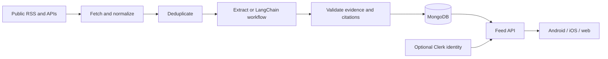

# Backend architecture

Zuno is a modular TypeScript application with two processes: an HTTP API and a
scheduled ingestion worker. Both use the same validated story contract and
MongoDB database. The Expo client consumes JSON over HTTP.

## Worker boundaries

Every five minutes, check all 80 public, curated source jobs that are eligible
under their persisted leases and backoff, with four source collections in flight. Fetch bounded responses
with timeouts and fail each source independently. Canonical URLs remove tracking
parameters. Repeated ingestion is safe because published IDs are deterministic.

Each cycle attempts up to 30 edited briefs (50 excerpts), with three editorial
groups in flight. Evidence is claimed in three-entry waves so model work cannot
consume leases while waiting behind the rest of the batch. Claimed evidence keys
are excluded from later waves in the same run, so retries cannot consume the
remaining editorial budget before fresh evidence. The worker persists
source leases and editorial retry state. A lease prevents overlapping
processes from processing the same run. Atomic insert-if-absent publication is
the final duplicate barrier. Same-event grouping is conservative; the MVP does
not claim semantic understanding of all related coverage.

Model editing is a fixed sequence of three LangChain chat-model calls: writer,
humanizer and verifier. It receives bounded evidence. It cannot browse the web, run a shell
or inspect host files. All model instructions live in `prompts/`. Rewritten headlines and
points need complete claim reviews with exact source quotes and preserved numeric
facts. Model review is fallible and needs evaluation before public release.
Extractive mode identifies snippets rather than claiming to read full articles.

## Serving boundaries

Only validated published stories reach the feed. Pagination sorts by publication
time and story ID, using an opaque validated cursor. Topic filters remain
consistent between pages. Public reads do not create guest accounts.

Personal identity is optional. The API verifies Clerk tokens for identity routes;
it never trusts a client-supplied user ID. Request validation, CORS and rate limits
apply at the HTTP boundary. There is no administrative publishing HTTP endpoint.

## Storage

MongoDB stores published stories and worker state. The in-memory adapter is for
tests and explicit demo sessions. It is not a production persistence substitute.
No Redis, vector database, message broker or separate recommendation service is
required for this release. Add these only after measuring a specific bottleneck.

## Dependency and readability rules

Mobile depends on shared contracts. API and worker depend on shared contracts
and storage; neither imports the other. Storage depends on shared, and shared
stays independent of server runtimes. Production code cannot import tests or
development scripts. `npm run check:architecture` checks these dependencies;
its regression tests exercise forbidden imports as well as the current tree.
The check inspects literal imports, re-exports and runtime imports, and blocks
Node built-ins and known server packages in client/shared code. Computed imports
and transitive third-party dependencies still require review.

Keep parsing, validation, fetching, persistence and orchestration in their
existing focused files. Group new files by feature when that improves navigation.
Use workspace entry points for public contracts and concrete local imports for
internal helpers. Worker concurrency and cycle budgets are named in `policy.ts`;
their values retain the existing production behavior.

These rules adopt the useful inward-dependency, executable-structure and named
policy patterns from [Dealgraph](https://github.com/devwithadi/dealgraph/tree/84543b76a48944f74c780e1dede7947438ab917b).
The review covered its agent guide, structure tests, domain models, sourcing
policy and pipeline. Zuno retains its own TypeScript workspaces, feature folders,
100-line limit and validated evidence workflow. Large pipeline modules and broad
untyped payloads are not patterns to reproduce.

Cover images come from publisher feeds or public article metadata. Image URLs
must use approved publisher hosts or explicitly registered image CDNs. Missing
covers are checked even when feed text is complete; oversized public pages may
provide a 64 KB metadata preview, which never replaces article evidence.

## Product boundary

The MVP offers guest scrolling, topic filters, cited pointers, source links,
optional login, refreshed content and a consistent visual fallback per topic.
Notifications, portfolios, live price data, comments and user submissions are
outside this release.
